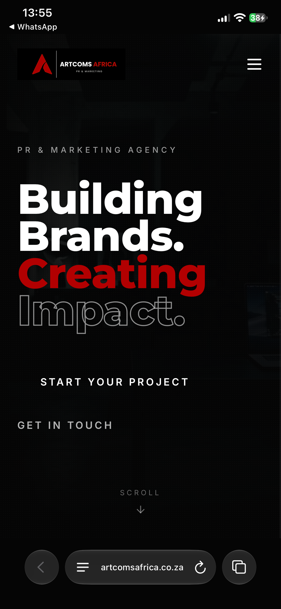
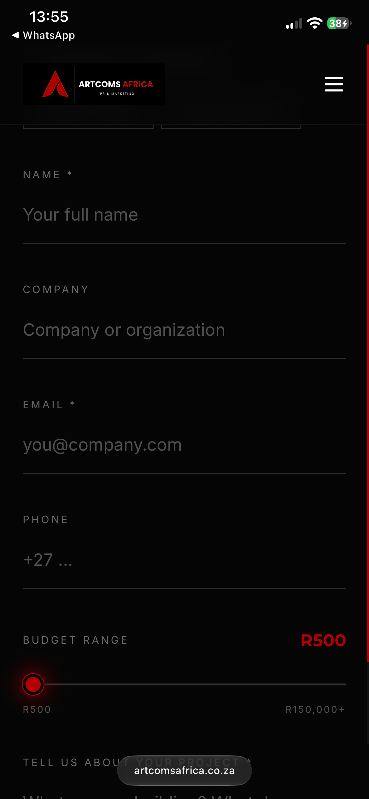

# Agency Website with Automated Package Proposals

A live marketing agency website where a visitor picks a package, submits an enquiry, and automatically receives a personalised PDF proposal by email. No manual work needed from the team.

**Live site:** https://artcomsafrica.co.za

## The problem
Enquiries came in one at a time and each needed a manual reply and a hand-made proposal.

## The solution
A website enquiry form connected to a Make.com automation that handles everything after the visitor taps submit.

## How it works
1. Visitor selects a package and submits the enquiry form
2. A Make.com webhook receives the form data
3. The scenario finds the matching proposal template in Google Drive
4. A personalised Google Doc is created from the template (client name and selected services filled in)
5. The document is exported as a PDF
6. The client gets a confirmation email with their package summary and the PDF attached
7. An internal email notifies the team

## Tools used
Base44 (AI-assisted site builder), Make.com, Webhooks, Google Drive, Google Docs, Gmail

## Screenshots

## Automation blueprint
The exported Make.com scenario is in `package-enquiry-scenario-blueprint.json`. Webhook URLs, connection IDs, folder IDs and contact details have been replaced with placeholders.

## What I learned
(Add 2-3 lines in your own words. For example: what was hardest, or what you'd improve.)

## Built by
Molebogeng Matipwili, AI automation specialist
